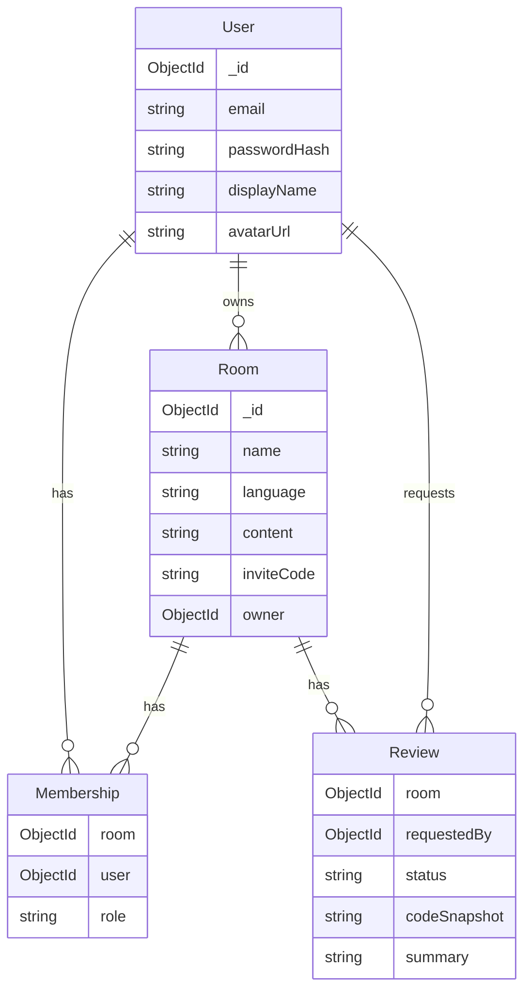

# CodeReview Live

Real-time collaborative coding interview and code review platform. People share one room, edit the same buffer together, and request an on-demand AI review of the code that is in the room at that moment.

The backend is being built milestone by milestone: layered Express services, Mongoose models, Socket.io for live editing, and an AI provider hidden behind an interface. The frontend (React + TypeScript), Docker, and GitHub Actions come after the API is stable.

## Tech stack

| Area | Choice |
|---|---|
| Runtime | Node.js |
| HTTP | Express 5, TypeScript |
| Database | MongoDB with Mongoose |
| Realtime | Socket.io (later milestone) |
| Auth | JWT, bcrypt password hashes (later milestone) |
| AI | Provider interface, with an OpenAI implementation (later milestone) |
| Frontend | React, TypeScript |
| DevOps | Docker, Docker Compose, GitHub Actions |

Dev server: `tsx`. Configuration comes from environment variables via `dotenv`.

## Getting started

From `backend/`:

```bash
npm install
cp .env.example .env
npm run dev
```

`GET http://localhost:5000/api/health` returns:

```json
{
  "status": "ok",
  "api": "up",
  "database": "connected"
}
```

`status` is `degraded` and the response is `503` when the API is up and MongoDB is not connected. Unknown routes return JSON through the global error handler.

| Variable | Default |
|---|---|
| `PORT` | `5000` |
| `MONGODB_URI` | `mongodb://127.0.0.1:27017/codereview-live` |
| `NODE_ENV` | `development` |

## Database schema

One shared code buffer per room (`language` + `content`). Membership is its own collection so “rooms I belong to” and one role per user are straightforward to query. Reviews are stored separately so each review freezes the code that was reviewed. Findings stay embedded on the review.



Domain models are introduced in later milestones. Milestone 1 only connects to MongoDB.

### User — `users`

| Field | Notes |
|---|---|
| `email` | required, unique, lowercase, trimmed |
| `passwordHash` | required, `select: false` so queries omit it by default |
| `displayName` | required, trimmed |
| `avatarUrl` | optional string |
| timestamps | `createdAt`, `updatedAt` |

`toJSON` omits `passwordHash`. A user’s rooms are loaded through `Membership`.

### Room — `rooms`

| Field | Notes |
|---|---|
| `name` | required, trimmed |
| `language` | required enum: `javascript`, `typescript`, `python`, `java`, `plaintext` |
| `content` | string, default `""`. The live buffer, persisted on edit |
| `inviteCode` | required, unique, short random code used to join |
| `owner` | `ObjectId` ref `User`, required, indexed |
| timestamps | yes |

The creator is also a `Membership` with role `owner`. Permission checks use membership. `Room.owner` stays the record of who created the room.

### Membership — `memberships`

| Field | Notes |
|---|---|
| `room` | `ObjectId` ref `Room`, required |
| `user` | `ObjectId` ref `User`, required |
| `role` | enum `owner`, `editor`, `viewer`, required |
| `joinedAt` | default `Date.now` |

Compound unique index on `{ room: 1, user: 1 }`. Index `{ user: 1 }` for “my rooms”.

Role rules live in services:

- **Owner:** edit code, request reviews, change other members’ roles, remove members, delete the room, regenerate the invite code. The owner role itself stays on the creator.
- **Editor:** edit code, request reviews, read members.
- **Viewer:** read code and reviews. Socket updates from a viewer are rejected.

### Review — `reviews`

| Field | Notes |
|---|---|
| `room` | `ObjectId` ref `Room`, indexed |
| `requestedBy` | `ObjectId` ref `User` |
| `status` | `pending`, `completed`, `failed` |
| `codeSnapshot` | string copy of `room.content` at request time |
| `language` | copied from the room |
| `summary` | string, empty until completed |
| `findings` | embedded array |
| `provider` | string, for example `openai` |
| `model` | string |
| `errorMessage` | string, set when `failed` |
| `createdAt` / `completedAt` | timestamps plus an explicit completion time |

Finding subdocument:

- `severity`: `info`, `warning`, `error`
- `category`: `bug`, `refactor`, `style`, `security`
- `message`: string
- `suggestion`: optional string
- `lineStart`, `lineEnd`: optional numbers

Findings are always loaded with their review.

## Folder structure

`index.ts` starts the process. `app.ts` builds the Express app so tests can import it without listening.

```
backend/src/
  index.ts                  listen + connect DB + attach sockets
  app.ts                    express(), middleware, mount routers
  config/
    env.ts                  read and validate process.env
    db.ts                   mongoose.connect
  models/
    User.ts
    Room.ts
    Membership.ts
    Review.ts
  types/
    roles.ts                Role union and permission helper types
    express.d.ts            Request.user
  routes/
    auth.routes.ts
    user.routes.ts
    room.routes.ts
    review.routes.ts
  controllers/              parse req/res only, call a service
    auth.controller.ts
    user.controller.ts
    room.controller.ts
    review.controller.ts
  services/                 business rules, no req/res
    auth.service.ts
    user.service.ts
    room.service.ts
    membership.service.ts
    review.service.ts
    ai/
      AiReviewProvider.ts   interface: review(code, language) => summary + findings
      OpenAiReviewProvider.ts
  middleware/
    auth.middleware.ts      verify JWT, set req.user
    requireRole.ts          load membership, reject insufficient role
    error.middleware.ts
    asyncHandler.ts
  sockets/
    index.ts                Socket.io server, JWT on handshake
    room.handler.ts         join room, code:update, presence
  utils/
    AppError.ts
    inviteCode.ts
backend/tests/              one file per service
```

Milestone 1 has `app.ts`, `config/env.ts`, `config/db.ts`, `middleware/error.middleware.ts`, and `utils/AppError.ts`. The other files in that tree are the target layout for later milestones. Empty folders are reserved for them. Domain model files are intentionally absent.

Dependency direction: routes → controllers → services → models. Socket handlers call the same room and membership services as HTTP. Controllers and socket handlers do not import Mongoose models.

Real-time editing uses Socket.io with permission checks and last-write-wins content sync. CRDTs stay out of this version. AI calls go through `AiReviewProvider` so routes never talk to a vendor SDK directly.

## Roadmap

**Status:** Milestone 1 is implemented. Milestones 2–6 are next.

Each milestone keeps `GET /api/health` working. New behavior gets service-level tests before the next feature starts.

1. **Foundation.** Folder layout, `config/env.ts`, `config/db.ts`, `AppError`, and global error middleware. `app.ts` is separate from `index.ts`. `GET /api/health` reports API and database status. Mongoose is installed. Domain models wait.
2. **Users and JWT.** `User` model. Register, login, `GET /api/users/me`, `PATCH /api/users/me`. bcrypt hashes, JWT in `Authorization: Bearer`. Passwords are omitted from responses. Tests cover duplicate email, wrong password, and a protected route without a token.
3. **Rooms and roles.** `Room` and `Membership`. Create room (creator becomes the owner membership), list my rooms, get room (members only), join by invite code as editor, update role, remove member, delete room (owner). Permission checks live in `membership.service.ts`.
4. **Realtime editing.** Socket.io on the same HTTP server. Handshake requires a valid JWT. Events: `room:join`, `code:update`, `presence:update`. Editor and owner may broadcast content; a viewer is rejected. Debounced persist of `room.content` goes through `room.service.ts`. `GET /api/rooms/:id` remains the source of the latest saved content.
5. **AI review.** `Review` model and `AiReviewProvider`. `POST /api/rooms/:id/reviews` (owner or editor) saves a `pending` review with a code snapshot, calls the provider, then marks `completed` or `failed`. `GET` list and `GET` one review for any member. The provider is injected into `review.service.ts` so tests use a fake.
6. **DevOps.** Dockerfile, docker-compose (API + MongoDB), and a GitHub Actions workflow that typechecks and runs tests.

### Planned HTTP API

- `POST /api/auth/register`, `POST /api/auth/login`
- `GET /api/users/me`, `PATCH /api/users/me`
- `POST /api/rooms`, `GET /api/rooms`, `GET /api/rooms/:id`, `POST /api/rooms/join`, `PATCH /api/rooms/:id/members/:userId`, `DELETE /api/rooms/:id`
- `POST /api/rooms/:id/reviews`, `GET /api/rooms/:id/reviews`, `GET /api/reviews/:id`

`GET /api/health` is the only route implemented today.
